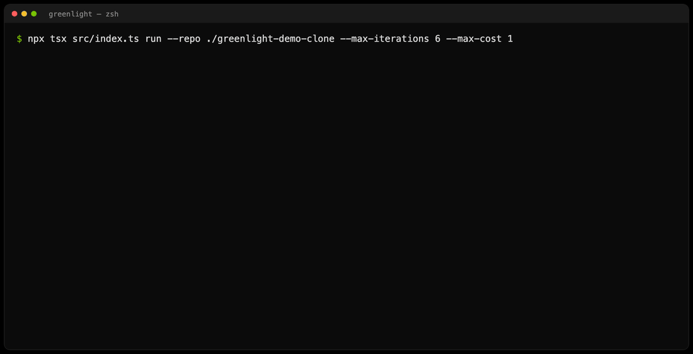
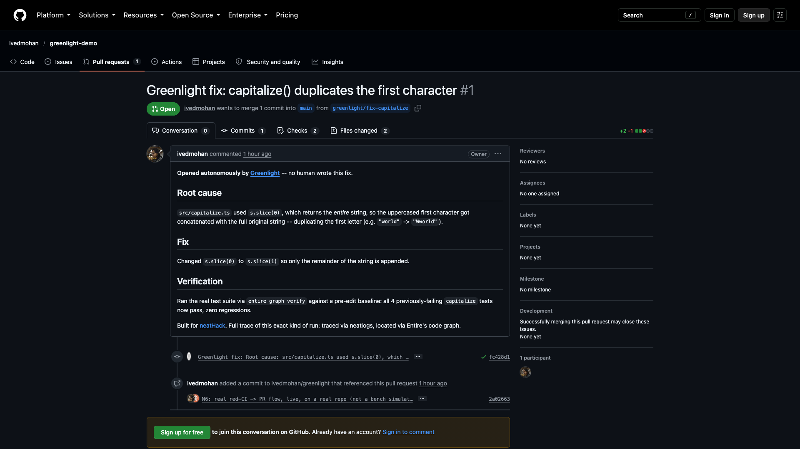
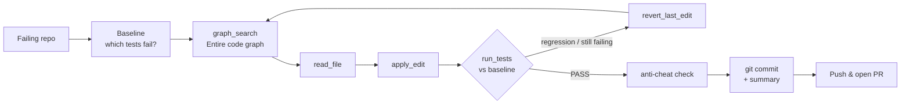

<div align="center">

# 🟢 Greenlight

**Red CI in. A verified fix out.**

An autonomous agent that takes a repo with failing tests, finds the root cause, patches it,<br>
proves the fix against a baseline, and commits it, ready to ship as a pull request. No human in the loop.


[**Live demo repo**](https://github.com/ivedmohan/greenlight-demo) · [**The real PR it produced**](https://github.com/ivedmohan/greenlight-demo/pull/1) · [**Build log**](./hackathon.md) · [**Evidence**](./evidence)



</div>

---

## What is it?

When CI goes red, someone has to stop what they're doing, read the failure, hunt down the bug, fix it, and prove the fix didn't break anything else. **Greenlight does that whole loop by itself.**

You give it a repo and a test command. It:

1. **Reproduces** the failure and records a baseline of exactly which tests fail.
2. **Locates** the likely fix site by searching [Entire](https://entire.io)'s runtime code graph, not by grepping.
3. **Patches** the code with small, exact edits.
4. **Verifies** against the baseline: the failing tests must now pass, nothing else may regress, and no test may be deleted or skipped to "cheat".
5. **Recovers** when a guess is wrong. It reverts, reads the error, and tries a new hypothesis, all within an attempt and dollar budget.
6. **Commits** the fix with a root-cause summary, ready to push as a PR.

Every step is traced end to end in [neatlogs](https://neatlogs.com).

## Does it actually work?

Yes, on a real repo with real CI, not a simulation.

| | |
|---|---|
| 🔴 **Before** | [greenlight-demo](https://github.com/ivedmohan/greenlight-demo/actions): `main` has a real `capitalize()` bug and GitHub Actions is genuinely red, with 4 failing tests. |
| 🤖 **Run** | One unmodified `greenlight run`: **5 steps, $0.0166, fixed.** |
| 🟢 **After** | [PR #1](https://github.com/ivedmohan/greenlight-demo/pull/1): root cause, fix and verification, written by the agent. The PR's own CI **passes**. |

<p align="center"></p>

On the seeded [benchmark](./bench) it fixes **8 of 9** attempted cases (up from 6 of 9 before we used the neatlogs traces to improve it) at about **$0.0165 per fix**.

## How it works



The agent drives the loop itself with tool calls. Nothing is hard-coded per bug:

| Tool | What it does |
|---|---|
| `graph_search` | Ranked candidate fix sites from Entire's code graph: source, `file:line`, callers |
| `graph_explain` | Resolves the declaration of every symbol named in the failing test output / stack trace |
| `read_file` | Reads a file or a line range |
| `apply_edit` | Exact-match replace (must match exactly once, so there are no fuzzy edits) |
| `run_tests` | Runs the suite and returns a verdict vs. the baseline: newly passing, still failing, regressions |
| `revert_last_edit` | Throws away a failed hypothesis and returns to the baseline |
| `finish` | Ends the run with a root-cause summary, or explains why it gave up |

### Guardrails

- **Baseline-relative verification.** "Pass" means the originally failing tests now pass *and* nothing that passed before now fails.
- **Anti-cheat.** Deleting a test file or adding `.skip` / `.todo` makes the fix count as a failure ([`src/verify.ts`](./src/verify.ts)).
- **Budgets.** `--max-iterations` and `--max-cost` hard-stop runaway loops.
- **Real recovery.** In [this traced run](./evidence/neatlogs-traces.md#recovery-evidence-real-not-staged) the agent opened the wrong file, got `ENOENT`, and picked the right file on the very next call, with no scripted retry.

## Quickstart

### 1. Prerequisites

- **Node.js 20+**
- **[Entire CLI](https://entire.io)** on your `PATH` (powers `graph_search` and verification)
- A **[Groq](https://console.groq.com) API key**. The default model is `qwen/qwen3.8-27b`, and the free tier works.
- *(Optional)* A **[neatlogs](https://neatlogs.com)** key and project ID for tracing
- *(Optional)* The **[GitHub CLI](https://cli.github.com)** (`gh`) to open the PR

### 2. Install

```bash
git clone https://github.com/ivedmohan/greenlight.git
cd greenlight
npm install
cp .env.example .env
```

Fill in `.env`:

```bash
GROQ_API_KEY=...            # required
GROQ_MODEL=qwen/qwen3.8-27b # optional, this is the default
NEATLOGS_API_KEY=...        # optional, enables tracing
NEATLOGS_PROJECT_ID=...
```

### 3. Try it on a seeded bug (no setup needed)

```bash
npm run dev -- run --case stringkit/easy-capitalize
```

This copies a known-buggy project into `runs/<run-id>/workspace`, then lets Greenlight fix it. Swap in any of the [10 bench cases](./bench/README.md#the-10-cases), for example `stringkit/hard-shared-isplainobject`.

### 4. Point it at your own repo

```bash
cd /path/to/your-repo && git checkout -b greenlight/fix   # work on a branch
cd -                                                      # back to greenlight
npm run dev -- run --repo /path/to/your-repo --test "npm test"
```

When it reports `"status": "fixed"`, the fix is already committed on your branch. Ship it:

```bash
cd /path/to/your-repo
git push -u origin HEAD
gh pr create --fill
```

### CLI reference

```
greenlight run [options]
```

| Option | Default | Description |
|---|---|---|
| `--repo <path>` | | Repo with a failing test command |
| `--case <project/id>` | | Run against a seeded bench case instead |
| `--test <cmd>` | `npm test` | Command that reproduces the failure |
| `--max-iterations <n>` | `5` | Max fix attempts before giving up |
| `--max-cost <usd>` | `1` | Hard dollar budget for LLM calls |

The exit code is `0` when the run is fixed and `1` otherwise, so it drops straight into CI.

<details>
<summary><b>Example output</b></summary>

```
[tool] graph_search({"query":"capitalize duplicates the first character"})
  -> 1. src/capitalize.ts:1-4 score=21.08 symbol=capitalize kind=function
[tool] read_file({"path":"src/capitalize.ts"})
[tool] apply_edit({"path":"src/capitalize.ts","old_str":"... s.slice(0);","new_str":"... s.slice(1);"})
[tool] run_tests({})
  -> NEWLY PASSING (4) ... VERDICT: PASS — fixes the target behavior, no regressions.

--- Greenlight run result ---
{
  "status": "fixed",
  "summary": "Root cause: src/capitalize.ts used s.slice(0), which returns the entire string ...",
  "attempts": 5,
  "costUsd": 0.0166,
  "commitSha": "fc428d11c5038c22253ec84522f798a83e0a45f3"
}
```
</details>

## Benchmark

Ten seeded bugs across two projects, from one-character typos to cross-file root causes, shared helpers that break two test files at once, and genuine timeouts. Details are in [`bench/README.md`](./bench/README.md).

```bash
npm run bench                                   # verify every seeded bug really fails as described
npx tsx bench/run-agent-bench.ts --label v1     # run the agent across all cases
npx tsx bench/run-agent-bench.ts --only stringkit/easy-clamp
```

| Model | Fixed | Cost per fix |
|---|---|---|
| `gpt-oss-120b` | 6 / 9 | n/a |
| **`qwen/qwen3.8-27b`** | **8 / 9** | **~$0.0165** |

Per-case results and trace IDs are in [`evidence/agent-bench-v1.json`](./evidence/agent-bench-v1.json).

## Built with

| | Role in Greenlight |
|---|---|
| **[neatlogs](https://neatlogs.com)** | Traces every LLM call and tool call. We used those traces to find a broken tracing init, correct our cost model and compare models: [evidence](./evidence/neatlogs-traces.md) |
| **[Entire](https://entire.io)** | The runtime code graph behind `graph_search`, `entire graph verify` for verdicts, and a checkpoint on every commit: [sample](./evidence/entire-graph-sample.txt) |
| **[cfo.ai](https://cfo.ai)** | Business case from our real measured costs: $3 per fix or $79 per repo per month, 91–95% contribution margin, breakeven at 52 repos: [plan](./evidence/cfo-ai-business-plan.md) |
| **[Groq](https://groq.com)** | Fast, cheap inference for the agent's own reasoning (OpenAI-compatible API) |

## Limitations

- **Timeouts are its weak spot.** The one benchmark case it still misses is a genuine test timeout. The agent doesn't yet tell "the test hung" apart from "the assertion failed".
- **Shipping the PR is one manual step** today: `git push` plus `gh pr create`. The agent stops at a verified commit.
- **Tested on TypeScript / Node repos** (vitest). Any test command works in principle, but other ecosystems haven't been benchmarked.

## Project layout

```
src/
  index.ts          CLI entry (greenlight run)
  agent/            loop, prompts + tool schemas, run state
  tools/            files, git, code graph (Entire), command runner
  verify.ts         anti-cheat checks
  tracing.ts        neatlogs setup
bench/              seeded buggy repos, cases, benchmark runners
evidence/           traces, benchmark results, unit economics, business plan
docs/               README media
hackathon.md        dated build log + submission checklist
```
